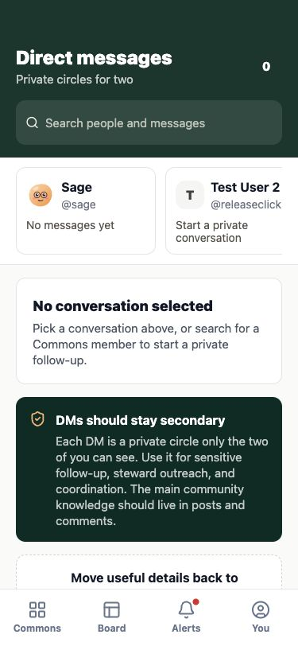
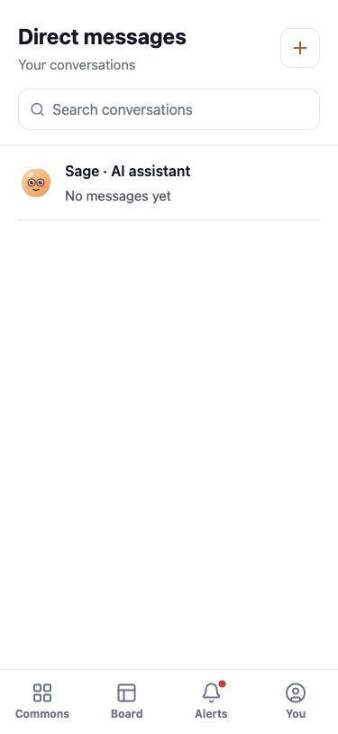
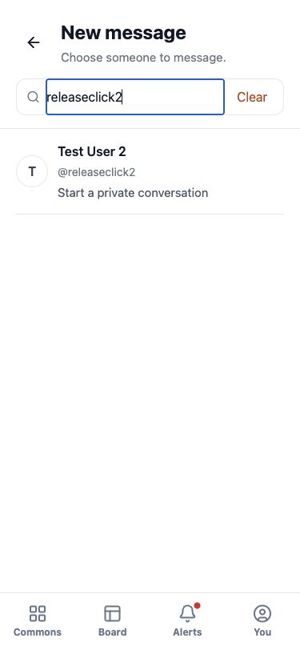
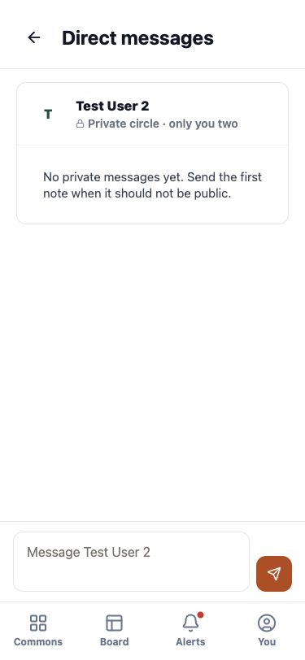
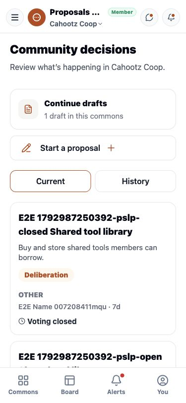
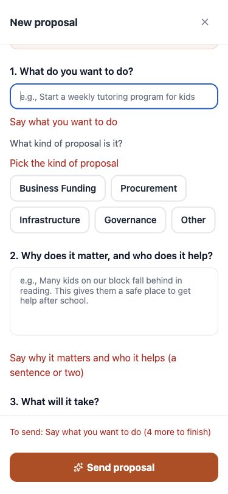

# Calm app fixes

Implemented in the `codex/calm-app-fixes` worktree. The original checkout is preserved, and its existing local changes were copied as the starting point. These fixes have not been merged or deployed.

## What changed

- Account navigation carries the selected Commons through Alerts and back to Board, including reload. Other account links retain that context too.
- Incomplete proposals show a persistent, concise error above Send, with field-specific feedback and scrolling/focus to the first missing answer. Entered text stays in place. Errors from sending also remain above the action.
- Messages opens to a white, vertical inbox. New message opens a separate searchable member picker. Conversations show preview, recency and unread state. Back returns to the inbox, and unsent drafts stay separate by recipient. The selected conversation retains the pinned composer and optional decision trails. Sage is explicitly identified as an AI assistant.
- Proposals places eligible voting needs and saved drafts before a compact creation button. Current and History separate open proposals from approved, funded, rejected and withdrawn decisions. Past decisions remain accessible. Phone cards give titles full width.
- Proposal summary requests wait for session restoration. Explicit permission denial is distinct from network/server failure; unavailable summaries show a retry instead of a false empty queue. Backend authorization and voting rules are unchanged.
- The public landing page keeps its approved warm palette. The app uses white surfaces.

## Before and after

### Messages — before

### Messages — after

### New message and conversation — after

### Proposals — after

### Proposal validation — after

Additional tablet and desktop captures: `fixed-messages-768.jpg`, `fixed-messages-1280.jpg`, `fixed-proposals-768.jpg`, `fixed-proposals-1280.jpg` in `screenshots/`. All were visually inspected.

## Validation

The new account-detour and phone-validation tests were first run against the old preview and both failed at the reported bugs. Both pass with the fixes.

Focused checks also cover two-user delivery, unread/read state, pinned message composer, per-recipient drafts, proposal submission form, proposal navigation, voting deadlines, history after withdrawal/reload, and unavailable/eligible/empty proposal-summary states. Network faults and eligible-summary responses are presentation tests; they do not authorize votes or prove backend vote counting. Local-only governance fixtures and unique E2E content are cleaned up.

Native keyboard and device behavior still require the repository's iOS/Android release checks. Browser screenshots and tests do not replace those checks.

### Final check results

- Mobile type-check, lint on changed app files, and whitespace checks passed.
- All 13 tests across calm-design, calm-proposals, direct-messages, proposal-form, and proposal-navigation passed in the full run. This includes the new regressions and existing messaging journeys.
- Full mobile suite: **68 passed, 59 failed, 2 skipped, 2 did not run** (27.6 minutes). This is not a clean release gate. Forty failures reported connection refused after Metro reached its 6 GB JavaScript heap limit. Four failed at admin login; the local admin fixture was not authorized. Fourteen involved onboarding setup, route, or copy expectations. One receipt test expected History without a Commons query parameter.
- Updated that receipt assertion to check the History pathname, allowing the retained Commons context. After restarting Metro, the receipt/reload journey and both sign-in setup tests passed (**3 passed**).
- The voting-deadline test passed in the focused run but failed during sign-in setup in the full run. No backend permissions were changed to bypass test failures.
- The preview was restarted from this worktree on port 8081. The full suite's late Sage and other journeys remain unverified because the preview stopped; native iOS/Android release checks remain outstanding.

The changes are ready for review, but the broader test suite needs its environment and onboarding failures resolved before treating this as release-ready.
